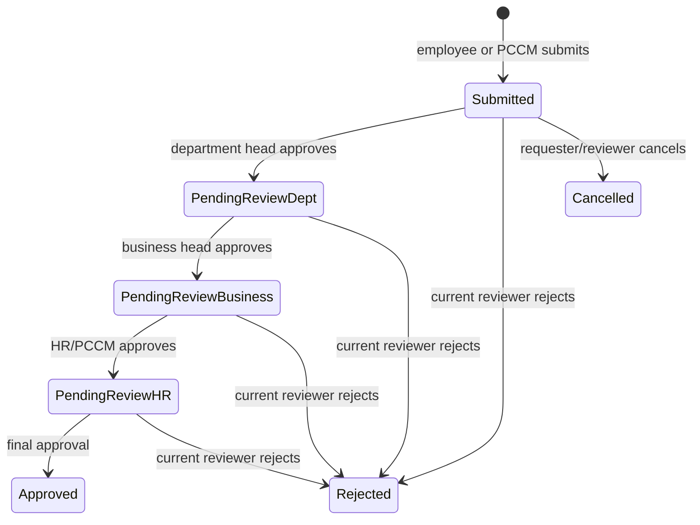
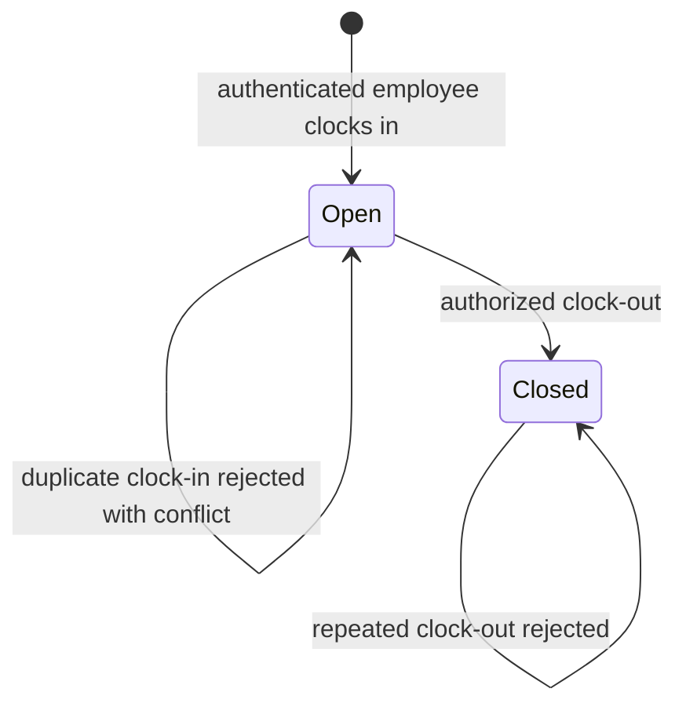
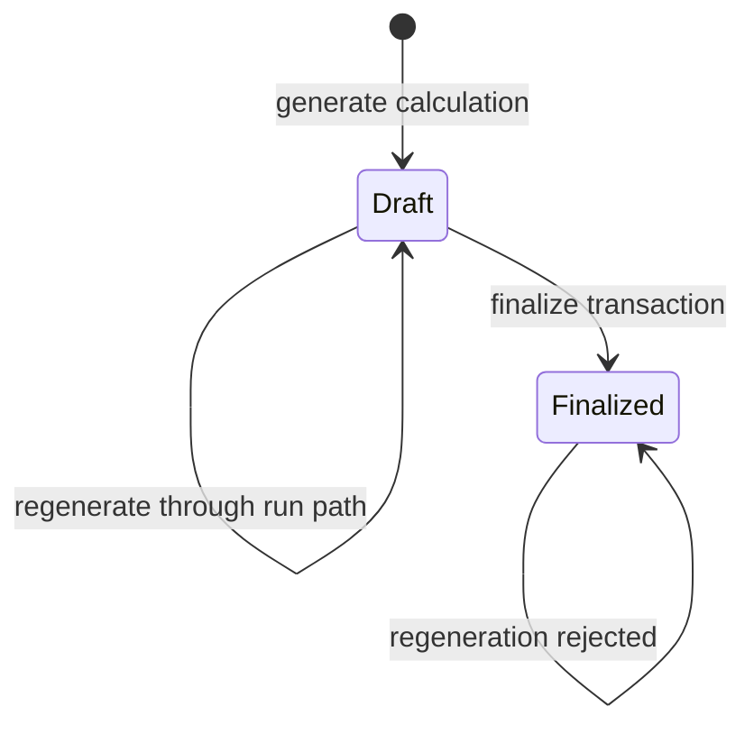
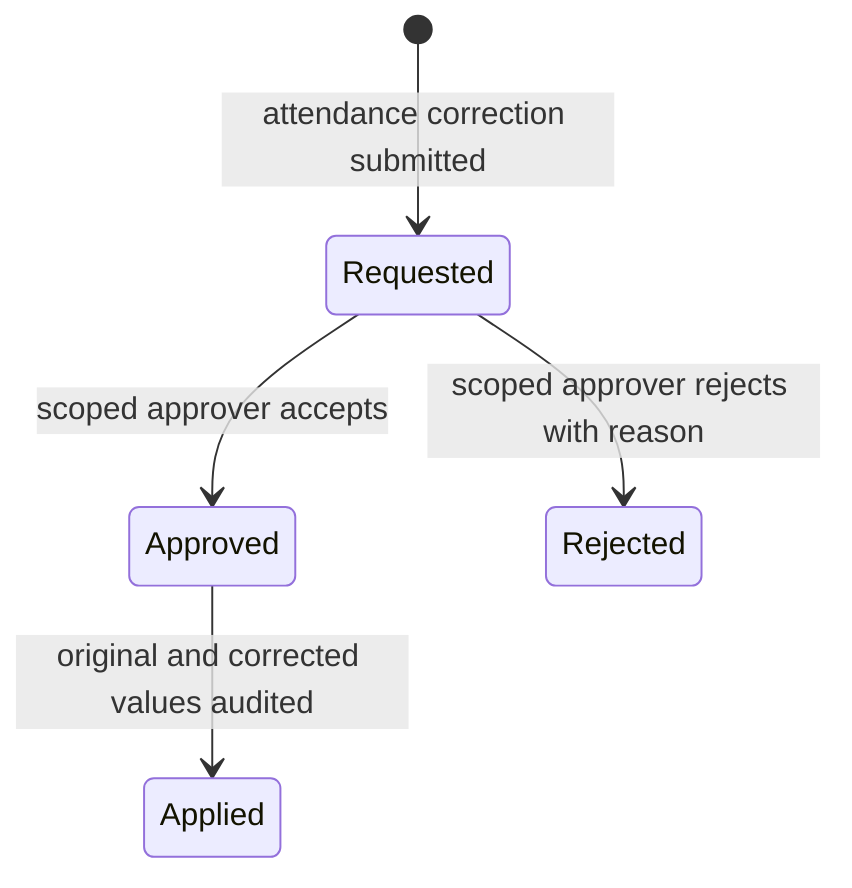
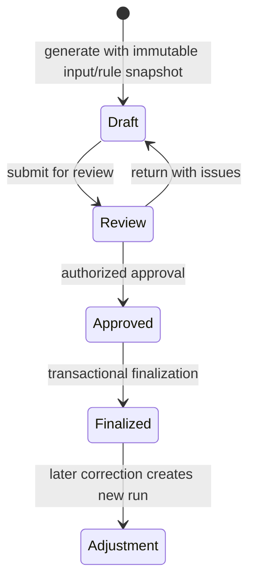
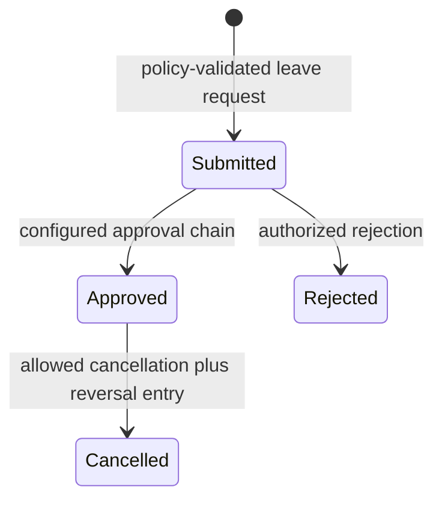

# Workflow diagrams

The first three diagrams show **CURRENT Citadel source behavior**. The final section marks future design proposals. They do not represent verified NotchHR internals.

## Leave approval (current)

Exact persisted labels are `Submitted`, `Pending Review`, `Approved`, `Rejected`, and `Cancelled`, with a separate `approval_stage` value. No balance ledger effects are currently performed.

## Attendance session (current)

## Payroll run (current)

The stored payroll run states and available review states should be confirmed before adding transitions. Current source has no explicit review/approval state machine.

## Proposed future workflow boundaries

These are independent designs pending policy decisions, not features verified in Citadel or NotchHR:

